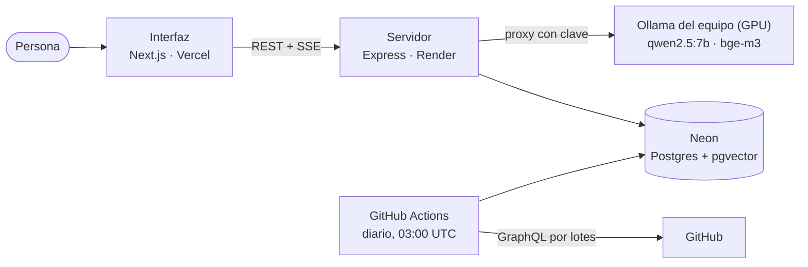

# OpenBridge

Catálogo inteligente de herramientas open source con asistente RAG que recomienda stacks según el negocio.

Simulación Laboral NoCountry — S10-26, equipo 8.

**Producción:** https://openbridge-blue.vercel.app · API: https://openbridge-api-utri.onrender.com/health

## Cómo funciona



- **Catálogo:** la ingesta diaria trae los metadatos de cada repositorio de `seed/repos.yaml`, calcula un puntaje de salud (0–100) y un nivel de mantenimiento, y lo guarda en Postgres. La interfaz lista, filtra y busca sobre esos datos.
- **Búsqueda por significado:** cada repositorio y cada idea aprobada tiene un vector (`bge-m3`) en pgvector. La consulta se vectoriza y se compara por similitud coseno.
- **Asistente:** a partir de la descripción de un negocio, el modelo identifica las capacidades técnicas que hacen falta (inicio de sesión, pagos, base de datos…); por cada una se busca en el catálogo y se elige el repositorio con mejor combinación de similitud, salud y popularidad. La propuesta llega a la interfaz por SSE (etapas y resultado) y se dibuja como mapa de arquitectura.

### Decisiones clave

- **Una sola base para todo.** Postgres con pgvector guarda datos y vectores: no hay una base vectorial aparte que mantener ni sincronizar.
- **El modelo no inventa herramientas.** El modelo solo descompone el negocio en capacidades; los repositorios recomendados salen siempre del catálogo curado. Las conexiones entre piezas que sugiere el modelo y que no vienen del catálogo se marcan en la interfaz para validarlas.
- **IA en una máquina del equipo.** Render no tiene GPU, así que Ollama corre en la máquina del equipo detrás de un proxy con clave, que solo deja pasar las rutas que usa la API ([docs/deploy.md](docs/deploy.md)). Si esa máquina está apagada, el catálogo sigue funcionando y el asistente responde `503 UPSTREAM_UNAVAILABLE`.
- **Contrato único.** La interfaz y el servidor hablan por un contrato de API versionado (`/api/v1`) con un objeto de error común; el cliente HTTP de la interfaz lo respeta en todas las pantallas.
- **Sin servidor, la interfaz no se rompe.** Sin `NEXT_PUBLIC_API_URL` usa datos de prueba; con la API caída, cada pantalla muestra un error con «Reintentar».

### Los tres desafíos del documento original

1. **Ingesta desde GitHub sin saturar la API.** Consultas GraphQL por lotes, manejo del límite de solicitudes con reintentos y una ejecución diaria programada que deja registro de cada corrida.
2. **Asistente que entiende el contexto, no solo palabras clave.** Generación aumentada por recuperación: primero busca por significado en el catálogo y después redacta la propuesta con lo que encontró.
3. **Ideas de integración como estructura, no texto plano.** Cada idea tiene un esquema validado (tipo de integración, pasos, etc.); el modelo genera borradores y solo las aprobadas se muestran y se vectorizan.

## Guión de la demo

Unos 5 minutos, sobre https://openbridge-blue.vercel.app.

**Antes de empezar** (con 5 minutos de margen):

1. Abrir https://openbridge-api-utri.onrender.com/health: en el plan gratuito el servidor se duerme a los 15 minutos y la primera consulta tarda cerca de 50 s.
2. Comprobar que la máquina con Ollama esté encendida, sin suspensión y con el túnel activo. De ella dependen la búsqueda por significado y el asistente: hacer una consulta de prueba en cada uno.
3. Elegir de antemano una ficha que tenga ideas de integración aprobadas.

**Recorrido:**

1. **Inicio.** Mostrar las categorías, los destacados y, en el pie de página, el total de herramientas y la última sincronización con GitHub.
2. **Catálogo y filtros.** Entrar a una categoría (por ejemplo, Autenticación), filtrar por «Mantenimiento: Activo» y «Stars mínimas: 10k+» y copiar la dirección: abierta en otra pestaña muestra los mismos resultados.
3. **Búsqueda por significado.** Buscar algo que no comparta palabras con los nombres, como «login con redes sociales», y ver que aparecen herramientas de autenticación.
4. **Ficha.** Abrir un repositorio: salud, métricas, licencia e ideas de integración.
5. **Asistente.** Ir a `/asistente` y pedir: _«Estoy construyendo un e-commerce B2B de logística»_. Mostrar las etapas, la propuesta justificada y el mapa de arquitectura, abrir una herramienta para ver su detalle y descargar el PNG con «Exportar PNG».

## Stack

- **Frontend:** Next.js + React + Tailwind CSS
- **Backend:** Node.js + Express (TypeScript), Zod
- **Datos:** PostgreSQL + pgvector, Drizzle ORM (Docker en local, Neon en producción)
- **IA:** LangChain.js + Ollama (`qwen2.5:7b` para generación, `bge-m3` para embeddings)
- **Ingesta:** GitHub GraphQL API + GitHub Actions (cron diario)

## Requisitos

- Node.js 22 o superior (`nvm use` toma la versión de `.nvmrc`)
- npm 10 o superior
- Docker con Docker Compose (para la base de datos local)

## Puesta en marcha

```bash
git clone <url-del-repo>
cd S10-26-equipo-8-OpenBridge
npm install   # instala frontend y backend (npm workspaces)
npm run dev   # levanta ambos en paralelo
```

- Frontend: http://localhost:3000
- Backend: http://localhost:4000/health → `{"status":"ok"}`

Variables de entorno del backend: copiá `backend/.env.example` a `backend/.env` si necesitás cambiar el puerto.

Sin `CORS_ORIGINS`, la API solo acepta consultas de navegador desde `http://localhost:3000`; cualquier otro origen recibe `403 ORIGIN_NOT_ALLOWED`. Si levantás la interfaz en otro puerto, agregalo: `CORS_ORIGINS=http://localhost:3000,http://localhost:3001`.

## Despliegue

Servidor en Render, base en Neon y el Ollama del equipo detrás de un proxy con clave. Pasos, variables y verificación en [docs/deploy.md](docs/deploy.md).

## Base de datos local

PostgreSQL 17 con pgvector (imagen `pgvector/pgvector`), equivalente a Neon en producción.

```bash
cp .env.example .env   # opcional; en cmd: copy .env.example .env
npm run db:up          # espera a que Postgres esté listo
```

Sin `.env`, Compose usa los mismos valores por defecto (`openbridge`).

Verificar que la extensión `vector` está habilitada:

```bash
npm run db:psql
# dentro de psql:
SELECT extname, extversion FROM pg_extension WHERE extname = 'vector';
```

- Los datos persisten en el volumen `pgdata`: `npm run db:down` los conserva.
- Los scripts de `docker/postgres/init/` solo corren con el volumen vacío. Para reiniciar la base desde cero: `docker compose down -v`.

### Esquema y migraciones (Drizzle)

El esquema vive en `backend/src/db/schema.ts` y las migraciones SQL en `backend/drizzle/`, versionadas en el repo.

```bash
cp backend/.env.example backend/.env   # define DATABASE_URL
npm run db:migrate -w backend          # aplica las migraciones pendientes
npm run db:seed -w backend             # carga las categorías base (idempotente)
```

Para cambiar el esquema: editá `schema.ts`, corré `npm run db:generate -w backend` y subí el SQL generado en el mismo PR. drizzle-kit no genera migraciones de reversa: un cambio se deshace con una migración nueva.

Los tests de base de datos crean una base temporal por archivo y le aplican las migraciones, así que necesitan Postgres levantado (`npm run db:up`).

## Ideas de integración con IA

El generador lee el README de cada repo y le pide a `qwen2.5:7b` (Ollama, vía LangChain.js) de 1 a 3 ideas en borrador que cumplan el esquema.

Cada versión de las instrucciones vive en `backend/prompts/ideas/<versión>/`, con un `system.md` y 3 ejemplos de referencia en `examples/`. Para cambiar las instrucciones, creá una carpeta nueva (`v3/`) en lugar de editar una existente: así se pueden comparar sobre los mismos repos con `--prompt`. Los ejemplos tienen que ser herramientas que **no** estén en el catálogo, porque si no, el modelo mezcla el README del ejemplo con el real (un test lo controla).

```bash
ollama pull qwen2.5:7b                                       # una sola vez
npm run db:generate-ideas -w backend -- --limit 5            # repos sin ideas, los más populares primero
npm run db:generate-ideas -w backend -- --repo supabase/supabase
npm run db:generate-ideas -w backend -- --limit 3 --prompt v1   # generar con otra versión
```

En Windows conviene Ollama nativo: usa la GPU (también AMD) y genera unas 3 ideas cada 10 segundos. Para instalarlo y verificar que use la GPU, seguí [docs/ia/ollama-local.md](docs/ia/ollama-local.md).

Necesita `DATABASE_URL` y `GITHUB_TOKEN` en `backend/.env`. Para Ollama se usan, si están definidas, `OLLAMA_BASE_URL` (por defecto `http://localhost:11434`) y `OLLAMA_MODEL` (por defecto `qwen2.5:7b`). Si una respuesta no cumple el esquema, se reintenta una vez; si vuelve a fallar, se descarta y queda en `backend/reports/ideas-report.json` con el motivo y la respuesta del modelo.

## Catálogo: filtros y búsqueda por texto

`GET /api/v1/repositories` combina filtros y búsqueda por texto:

| Parámetro      | Ejemplo             | Qué hace                                                                          |
| -------------- | ------------------- | --------------------------------------------------------------------------------- |
| `category`     | `auth`              | Slug de la categoría                                                              |
| `language`     | `Python`            | Lenguaje principal (sin distinguir mayúsculas)                                    |
| `license`      | `MIT`               | Licencia SPDX (sin distinguir mayúsculas)                                         |
| `q`            | `motor de búsqueda` | Texto libre (mínimo 2 caracteres) sobre nombre, descripción, temas y categoría    |
| `sort`         | `stars`             | `health` (por defecto), `stars`, `updated` o `relevance` (por defecto si hay `q`) |
| `page`, `size` | `2`, `20`           | Paginación                                                                        |

La búsqueda usa el texto completo de Postgres: los repos se indexan en inglés y las categorías en español, y la consulta se prueba con los dos idiomas. Por eso "motor de búsqueda" encuentra Meilisearch y Typesense por su categoría. Para lo que no comparte palabras con la consulta ("login con redes sociales") está la búsqueda por significado.

`GET /api/v1/filters` devuelve las opciones de los filtros a partir de los datos reales: lenguajes, licencias, categorías y niveles de mantenimiento con su cantidad de repos, y el rango de estrellas.

## Búsqueda por significado

`POST /api/v1/search` devuelve los repositorios e ideas aprobadas más parecidos en significado a un texto, con su similitud coseno (1 es idéntico; con `bge-m3`, lo relevante suele estar entre 0,4 y 0,7) y su categoría. Las ideas se filtran por la categoría y la salud de su repositorio.

```bash
curl -X POST http://localhost:4000/api/v1/search -H "Content-Type: application/json" \
  -d '{"query":"login único para empresas","limit":5,"categories":["auth"],"minHealth":60}'
```

Vectoriza la consulta con Ollama (`bge-m3`): si Ollama no responde, contesta `503 EMBEDDINGS_UNAVAILABLE`. Antes hay que generar los vectores del catálogo con `npm run db:embed -w backend`. Para probar consultas sin levantar el servidor:

```bash
npm run db:search -w backend -- "login único para empresas" --category auth --min-health 60
```

## Scripts (desde la raíz)

| Script                 | Qué hace                                                            |
| ---------------------- | ------------------------------------------------------------------- |
| `npm run dev`          | Frontend y backend en paralelo (`web` / `api`)                      |
| `npm run build`        | Compila frontend y backend                                          |
| `npm run lint`         | ESLint + Prettier (`--check`) en ambos; ESLint indica archivo:línea |
| `npm test`             | Tests de los workspaces (backend: Vitest + supertest)               |
| `npm run format`       | Formatea todo el repo con Prettier                                  |
| `npm run format:check` | Verifica el formato sin modificar archivos                          |
| `npm run db:up`        | Levanta Postgres + pgvector en segundo plano                        |
| `npm run db:down`      | Detiene la base (los datos se conservan)                            |
| `npm run db:logs`      | Sigue los logs del contenedor `db`                                  |
| `npm run db:psql`      | Abre `psql` dentro del contenedor                                   |

Cada workspace también se puede ejecutar solo: `npm run dev -w backend`.

## Estructura

```
.
├── frontend/          # Next.js (App Router) + Tailwind
│   └── src/app/
├── backend/           # Express + TypeScript
│   ├── src/           # app.ts (app), server.ts (listen)
│   └── test/          # Vitest + supertest
├── docs/              # documentación del proyecto
│   └── testing/       # estrategia de pruebas y DoD
├── docker/postgres/init/  # scripts de inicialización (extensión vector)
├── docker-compose.yml # Postgres + pgvector local
├── .env.example       # variables de Docker Compose
├── .editorconfig
├── .prettierrc
├── .nvmrc
└── package.json       # workspaces + scripts comunes
```

## Calidad

La estrategia de pruebas y la Definition of Done están en [`docs/testing/estrategia-de-pruebas.md`](docs/testing/estrategia-de-pruebas.md).

## Ramas

- `main`: producción, solo recibe merges desde `dev` o desde `hotfix/`.
- `dev`: integración; las ramas de trabajo salen de acá y vuelven por PR.
- Formato de las ramas de trabajo: `tipo/OB-XX-descripcion-corta`
  - Prefijos: `feature/`, `fix/`, `hotfix/`, `chore/`, `docs/`, `refactor/`, `test/`
  - Ejemplo: `feature/OB-12-busqueda-herramientas`

## Commits

Seguimos [Conventional Commits](https://www.conventionalcommits.org/es/): `tipo(alcance): descripción`, en inglés y en imperativo.

- **Tipos:** `feat`, `fix`, `chore`, `docs`, `refactor`, `test`, `style`
- **Alcances:** `web`, `api`, `db`, `ingest`, `rag`, `ci`

```
feat(api): add tool search endpoint
fix(web): fix category filter in catalog
```
